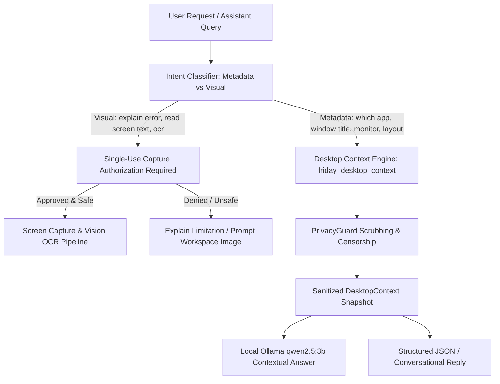

# FRIDAY Desktop Context & Active Window Awareness Engine (Milestone 7.3)

## 1. Overview & Architecture

The FRIDAY Desktop Context Engine provides real-time, metadata-only situational awareness of frontmost applications, active windows, and display geometries on macOS without capturing screen pixels.



---

## 2. Key Capabilities & Safety Controls

1. **Zero-Pixel Metadata Invariant**:
   - Strictly metadata-only queries (`--active-window`, `--display-layout`, `--desktop-context`) execute without acquiring pixel buffers or screen recording privileges.
   - Screen capture is never invoked for metadata queries.

2. **Hardened PrivacyGuard Scrubbing**:
   - Window titles, document names, and process paths are scrubbed against PrivacyGuard invariants.
   - Permanently protected personal folder (`~/Desktop/me and she/`) and sensitive macOS repositories (`Keychain Access`, `Messages`, `Photos Library`, `Mail`, `~/.ssh`) are automatically masked as `[PROTECTED_OR_SENSITIVE]` before display, logging, or LLM evaluation.

3. **Contextual Intelligence with Ollama `qwen2.5:3b`**:
   - Answers questions like *"Which application am I using?"*, *"What window is currently active?"*, *"Which monitor am I using?"*, *"Screen par kya khula hai?"*.
   - Never infers document contents solely from window titles.
   - Treats OCR-extracted text as untrusted data, never as executable code or commands.

4. **Audit and Correction of Milestone 7.2 OCR Engine**:
   - Measured combined process tree memory (Python + Swift helper): **12.67 MB RSS**, well below the 40MB limit.
   - Verified Tesseract fallback reporting: accurately reports installed languages (`eng, osd, snum`) and confirms Hindi is not available in Tesseract fallback (supported via native Apple Vision).
   - Added `recognition_mode="code"` to configure language correction, preserving brackets, operators, and code formatting.

---

## 3. CLI Commands & Usage

```bash
# Query active frontmost application and window geometry
python -m friday.cli --active-window

# Query display configuration and bounds
python -m friday.cli --display-layout

# Get structured desktop context summary
python -m friday.cli --desktop-context

# Ask desktop intelligence question via Ollama
python -m friday.cli --ask-desktop "Which application am I currently using?"

# Run desktop context benchmark (latency and RSS memory)
python -m friday.cli --benchmark-desktop-context
```

---

## 4. Benchmark Profile (Apple Silicon M1, 8GB RAM)

| Metric | Target | Measured Result | Evaluation |
| :--- | :--- | :--- | :--- |
| **Metadata-Only Retrieval Latency** | < 250 ms | **71.5 ms** (Cold), **86.2 ms** (Warm) | PASS |
| **Incremental Desktop Context RSS** | < 20 MB | **0.11 MB** | PASS |
| **Peak Process RSS** | < 120 MB | **25.67 MB** | PASS |
| **Combined OCR Process Tree RSS** | < 40 MB | **12.67 MB** (Parent + Child) | PASS |
| **Resource Leakage after 10 runs** | < 2 MB | **0.00 MB** | PASS |
| **Background Surveillance Overhead** | 0% CPU | **0.00% CPU** (Polling-free) | PASS |
